# LumiTwin — 가상 램프·전장 스마트공장

[](https://github.com/dgkim0996-crypto/lumitwin/actions/workflows/ci.yml)

자동차 램프와 전장(BMS·사이드미러)을 만드는 가상 공장의 3D 디지털 트윈과 MES입니다.
Python 가상 PLC가 설비 데이터를 MQTT로(또는 OPC UA → 엣지 게이트웨이를 거쳐) 보내면, MES 서버가 받아서 OEE·SPC·알람을 실시간으로 계산하고 시리얼 단위 공정 이력을 PostgreSQL에 쌓습니다.
MES는 기록만 하지 않고 생산을 **실행**합니다. 라인에 작업지시를 내려 주고, 게이트 설비가 투입할 때마다 인터록으로 허락·거부하고, 불량을 수리·재작업·폐기·특채로 처리하고, 의심 LOT를 Hold로 막습니다. 화면에서는 3D 공장 위에서 그 결과를 봅니다.

> 공개 자료([docs/research](docs/research))를 바탕으로 만든 **가상 공장**입니다. 특정 회사의 실제 라인·수치와 무관하며 대외비 데이터를 쓰지 않습니다. 모든 공정 파라미터에는 근거 등급(확인 / 약함 / 가정)을 달았습니다. 실제 라인에 넣으려면 무엇이 더 필요한지는 [현업 적용까지 남은 것](docs/PRODUCTION-GAP.md)에 정리했습니다.

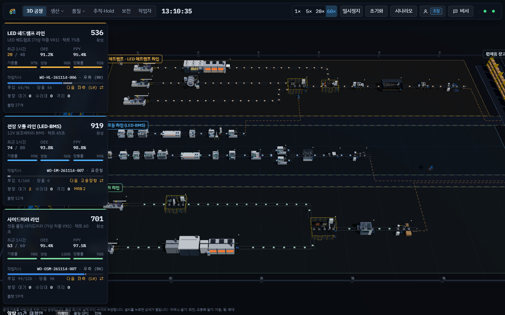

## 무엇을 보여 주나

| 항목 | 내용 |
|---|---|
| 공장 | 3개 라인, 40대 설비. 헤드램프(사출 → 하드코팅·증착 → 조립 → 기밀·배광·EOL), 전장(LED 레인: SMT → AOI → 라우터 → 모듈 시험, BMS 레인: SMT → AOI·ICT → 코팅 → FCT → EOL), 사이드미러(사출·도장 → 액추에이터 조립 → 기능 검사). AMR 3대가 라인 간 이송. 라인마다 기종 2개(헤드램프·미러는 좌·우, BMS는 표준형·고용량형) |
| 데이터 흐름 | SimPy 이산사건 시뮬레이터 → MQTT(`lt/v1/{line}/{station}/…`) → NestJS 내장 브로커(aedes) → 실시간 집계 → Socket.io → 3D 화면 |
| OPC UA 경로 | 현장처럼 **가상 PLC(OPC UA 서버) → 엣지 게이트웨이 → MQTT**로도 돌릴 수 있다(`npm run dev:opcua`). 태그는 엔지니어링 단위가 붙은 변수로 구독(값이 바뀔 때만), 상태 변경·생산 실적은 사용자 정의 OPC UA 이벤트로 받는다. MES에 묻는 인터록·작업지시 요청은 PLC 태그 핸드셰이크(요청 번호·응답 번호)로 주고받는다. 엣지는 주소 공간을 탐색해 태그 목록을 스스로 찾고, MQTT가 끊기면 실적을 버퍼에 쌓았다가 다시 보내며, 실적 순번으로 빠진 기록을 센다. MQTT 직행과 같은 기록이 나오는지 테스트로 확인한다([설계 5.7](docs/DESIGN.md#57-opc-ua-경로-가상-plc--엣지-게이트웨이)) |
| 실행 MES | **작업지시·생산 계획**: 라인 투입 공정은 MES가 내려 준 작업지시의 기종·수량만큼만 투입하고, 기종이 바뀌면 설비가 차례로 셋업한다. **공정 인터록**: 게이트 설비 17대가 투입할 때마다 MES에 묻는다. MES는 Hold → 불량 미처리 → 재검사 순서 → 공정 순서 → 작업지시 → 초물 순으로 판정하고, 거부한 개체는 격리 구역으로 간다. **불량 처리(NCR)**: 제품 경로에서 불량이 나면 NCR이 열리고, 처리 기준에 따라 수리·재작업·폐기를 자동으로 정하거나 MRB 판정을 기다린다. 수리한 개체는 수리대를 거쳐 불량이 난 공정에서 재검사한다. **Hold**: 자재 LOT·시리얼을 막고 영향 범위(상위 제품·완제품)를 본 뒤 해제하거나 폐기한다([설계 8장](docs/DESIGN.md#8-실행-mes)) |
| 품질 시스템 | 4M 변경점(교대·고장 수리·자재 LOT·기종 변경·보전은 설비가 감지, 그 밖은 사람이 신고)과 초·중·종물 검사. 변경 뒤 초물이 합격해야 게이트 설비가 다음 투입을 받는다. 관리계획서는 공장 정의에서 자동으로 만든다(특별 특성 ◆·▲와 근거) |
| 분석·예지 보전 | 교대 일보(주간 08~20시·야간 20~08시, CSV·인쇄), 설비·라인 전력량과 개당 에너지, 예지 보전(진동 ISO 10816-1 구역 등급·건강 지수·남은 수명 추정·보전 실시) |
| 로그인·감사 기록 | 역할 5개(작업자·조장·품질·보전·관리자)와 권한 12개. 상태를 바꾸는 요청은 서버가 로그인과 역할을 확인하고 감사 기록에 남긴다. 역할별로 할 수 있는 일은 [docs/MES.md](docs/MES.md) |
| 품질·테스트 | 공장 정의·OEE·6대 로스·설비 보전·SPC·보기 전용·AI 비서 도구·실행 MES 판정(인터록·계획·불량 처리)·변경점·관리계획서·교대 일보·예지 보전·로그인·시뮬레이터·OPC UA 경로 자동 테스트(`npm test`)와 GitHub Actions CI(타입 검사·테스트·빌드). 앱을 띄운 채 도는 화면 E2E(`npm run e2e`)와 부하 측정(`npm run loadtest`) |
| 품질 인과 | 원인 공정과 증상 공정이 다르다. 예: 전장 라인 LED 마운터 노즐 마모 → 헤드램프 라인 배광 불량. 이상 시나리오 11가지(설비 이상 10 + 불량 자재 LOT 입고 1)를 화면에서 켜고 끌 수 있다. 그중 `칩 마운터 헤드 베어링 마모`는 불량이 아니라 설비 수명 문제를 보여 주는 예지 보전 시나리오다 |
| MES | 설비·라인 OEE, FPY, X̄-R 관리도와 Cpk, 알람(고장·규격 이탈·품질·SPC·인터록·NCR·Hold·초물·예지 보전·변경점·작업지시), 완제품 → 부품 → 자재 LOT 계보 조회, 원격 명령(정지·재가동·고장·수리·보전). 서버를 다시 띄워도 실시간 집계와 실행 상태(작업지시·NCR·Hold·초물 대기)는 DB 기록에서 되살아난다([설계 5.6](docs/DESIGN.md#56-서버-재시작과-실시간-집계-복원)) |
| AI 현장 비서 | 공장 데이터 도구 22개(현황·설비·알람·SPC·6대 로스·설비 보전·파레토·요인 비교·LOT·계보·작업표준서 검색, 실행 MES의 작업지시·인터록·NCR·Hold·변경점·관리계획서·교대 일보·에너지·예지 보전)를 불러 답하는 챗봇. 조회만 하고 판정·Hold 같은 조작은 화면과 권한을 안내한다. API 키가 없으면 같은 도구를 규칙으로 부르는 모의 모드로 돈다. 가상 작업표준서 15건을 검색해 `[WS-OSM-02 §7]`처럼 인용하고, 음성으로도 묻는다(로컬 Whisper 또는 브라우저 음성 인식). 답 속 설비·LOT·인용을 누르면 그 화면으로 간다([설계 6장](docs/DESIGN.md#6-ai-현장-비서)) |
| 작업자 태블릿 | 설비 앞에서 쓰는 큰 버튼 화면. 사유를 골라 계획 정지·셋업·고장 등록(사유는 MES 상태 이력과 OEE 손실 구분에 들어감), 작업 전 점검 기록(항목은 작업표준서에서 읽고, 이상이면 MES 알람), 재가동·수리 전 안전 확인, 초물 대기 알림과 4M 변경점 신고, 표준서 조치 절 바로 열기, 말로 묻기([설계 7장](docs/DESIGN.md#7-작업자-태블릿과-배포)) |
| 공개 링크·배포 | 무료: 이 PC를 Cloudflare Tunnel로 HTTPS 공개, 공개 링크 방문자는 보기 전용(제어 키로 푼 뒤 로그인해야 조작)([deploy/cloudflare](deploy/cloudflare/README.md)). 상시 서버: Caddy(HTTPS) + pm2 설치 스크립트([deploy/aws](deploy/aws/README.md)), Oracle Cloud 상시 무료 ARM VM에 올리는 순서([deploy/oracle](deploy/oracle/README.md)) |

### 화면

위쪽 메뉴는 하는 일 단위로 묶었습니다: `3D 공장` · `생산`(생산 현황·작업지시·6대 로스·에너지·교대 일보) · `품질`(불량 처리·SPC·불량 분석·변경점·관리계획서) · `추적·Hold` · `보전` · `작업자`. 화면별 쓰는 법은 [docs/MES.md](docs/MES.md)에 있습니다.

| 경로 | 화면 | 볼 수 있는 것 |
|---|---|---|
| `/` | 3D 공장 | 설비 상태(경광등), 라인 카드(실적·OEE·FPY와 지금 작업지시·기종·진척·다음 기종, 불량 대기·수리대·격리 수), 알람, 설비 상세 패널, AMR 이송 |
| `/production` | 생산 현황 | 숫자 타일(완성·최근 1시간/목표·OEE·FPY·설비 상태), 시간대별 생산 막대(목표선), 설비별 상태 시간 구성과 OEE, 병목 후보(가동률×성능 최대) |
| `/orders` | 작업지시·생산 계획 | 진행 중 작업지시(양품·폐기·라인 안·미투입 진척), 대기 순서와 예상 투입 시각(기종 변경 셋업 포함), 만들기·순서 바꾸기·수량 고치기·중단, 지난 작업지시, 인터록 현황(통과·거부·대기·무응답 통과) |
| `/losses` | 6대 로스 | 공장·라인별 계획 시간 구성(가치 시간 = OEE + 고장·셋업·조정·순간 정지·공회전·속도 저하·공정 불량·초기 수율), 개선 우선순위(설비 × 로스, 기본은 대기 제외), 설비별 로스 구성 |
| `/energy` | 에너지 | 라인별 전력량과 완성품 1개당 전력량, 시간대별 전력량(가동·대기·정지 몫), 설비별 전력량. 구간은 최근 8시간·24시간·이번 실행 전체 |
| `/reports` | 교대 일보 | 교대(주간·야간)를 골라 라인별 목표 대비 실적·직행률·OEE·비가동 사유·불량 상위·NCR·4M 변경점·초중종물·인터록·전력량, 작업지시 계획 대비 실적. `CSV 내려받기`(엑셀용 UTF-8), `인쇄 / PDF 저장`(A4 세로, 결재란) |
| `/ncr` | 불량 처리 (NCR) | 처리 중·MRB 판정 대기·수리 성공률·평균 수리 시간·폐기·특채 타일, 부적합 목록(MRB 대기 강조), 상세(권하는 처리, 같은 시리얼 이력, 계보 열기)와 판정 버튼 `수리`·`재작업`·`폐기`·`특채 (그대로 사용)`, 많이 난 불량 |
| `/spc` | SPC | 관리 항목 목록(Cpk 등급·최근 이탈), X̄·R 관리도(Western Electric 규칙 위반 표시), 개별값 히스토그램과 규격선, Cp·Cpk·Ppk |
| `/quality` | 불량 분석 | 라인 불량 파레토, 불량 요인 비교(불량품과 같은 시기 양품의 공정값을 하위 부품까지 따라가 효과 크기 순으로), 자재 LOT 편중, 출하 유출 |
| `/changes` | 변경점·초중종물 (4M) | 4M 분류 요약, 변경점 시간순 표(초물 상태·`승인`), 초물 대기 설비(경과 시간, 품질 담당 `수동 합격`·`불합격`), 초·중·종물 기록(측정값 펼쳐 보기), `+ 변경점 신고` |
| `/control-plan` | 관리계획서 | 라인별 관리계획서(공정·특성·규격·평가 방법·시료·관리 방법·이상 시 조치·근거 등급), 특별 특성 기호와 근거, A4 가로 인쇄 |
| `/trace` | 추적·Hold | 시리얼 검색과 계보(정·역추적), 자재 LOT별 불량률(같은 자재의 다른 LOT 대비 편중 의심), LOT의 영향 제품(회수·격리 범위, CSV). 계보의 `Hold`·LOT 상세의 `이 LOT Hold`로 Hold 걸기, Hold 목록·상세(영향 범위, 격리 묶음)·`해제하기`/`폐기로 끝내기`, 격리 구역 표. `/trace?lot=…`·`?serial=…`로 바로 열 수 있다 |
| `/maintenance` | 설비 보전 | 고장·MTBF·MTTR·가용도·계획 보전 타일, 고장 타임라인, 설비별 MTBF·MTTR 실적과 설계, 계획 보전 경과, 작업 전 점검, 고장 사유, 최근 고장. **예지 보전(상태 감시)**: 설비별 진동 등급(양호·관찰·경고·위험), 진동 추이, 건강 지수, 전류·온도, 남은 수명 추정, `보전 실시` |
| `/operator` | 작업자 태블릿: 설비 고르기 | 라인별 설비와 지금 상태, 마지막에 쓴 설비로 `이어서` |
| `/operator/{설비 코드}` | 작업자 태블릿: 설비 화면 | 상태·사유, 설비 조작(계획 정지·셋업·고장 등록·재가동·수리 완료), 초물·변경점(초물 대기면 크게 경고, `변경점 신고`), AI 비서에게 묻기(말로 묻기), 이 설비 알람, 공정 조건, 작업 전 점검, 작업표준서, 최근 가공. 가로 태블릿은 두 열, 세로·휴대폰은 한 열 |
| `/login` | 로그인 | 시연 계정 버튼 5개(누르면 그 역할로 바로 로그인), 아이디·비밀번호, 역할별 권한 표 |
| `/audit` | 감사 기록 (관리자) | 누가·언제(실제·가상 시각)·무엇을 했는지. 사용자·동작으로 거르기 |
| 모든 화면 오른쪽 | AI 현장 비서 | 위쪽 `AI 비서` 버튼 또는 Ctrl+/. 조회한 도구와 결과 요약, 답(표·목록), 작업표준서 창, 음성 입력, 멈춤·새 대화. 열면 화면 내용이 패널 왼쪽으로 비켜 서고 좁으면 한 단으로 접힌다 |
| 위쪽 오른쪽 | 사용자 메뉴 | 로그인 안 했으면 `로그인`, 했으면 이름·역할 → 할 수 있는 일, `감사 기록`(관리자), `다른 계정으로 로그인`, `로그아웃` |

### 화면 모습

가상 60배속으로 몇 시간 돌리고 이상 시나리오 3개(렌즈 금형 온조기 이상·LED 마운터 노즐 마모·웜기어 세트 불량 LOT 입고)를 켜고 증착기 한 대에 고장을 넣은 상태에서, OPC UA 경로(`npm run dev:opcua`)로 찍었습니다. AI 비서는 API 키 없이 도는 모의 모드입니다.

| 생산 현황 | 6대 로스 |
|---|---|
| 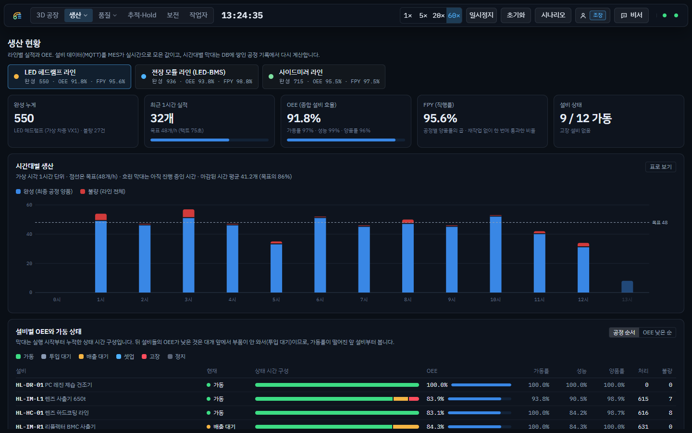 | 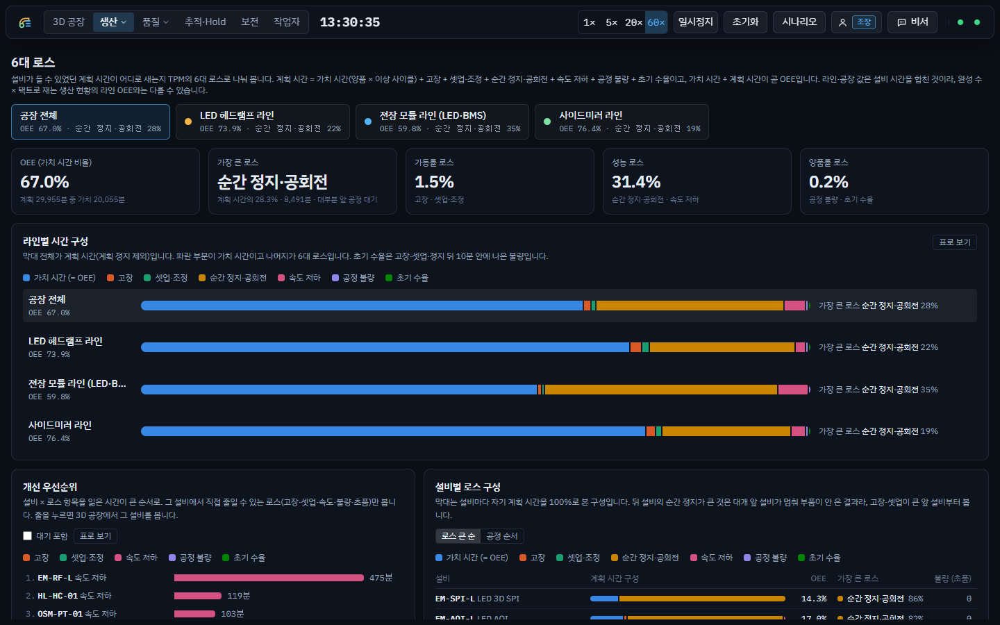 |
| **설비 보전** | **SPC** |
| 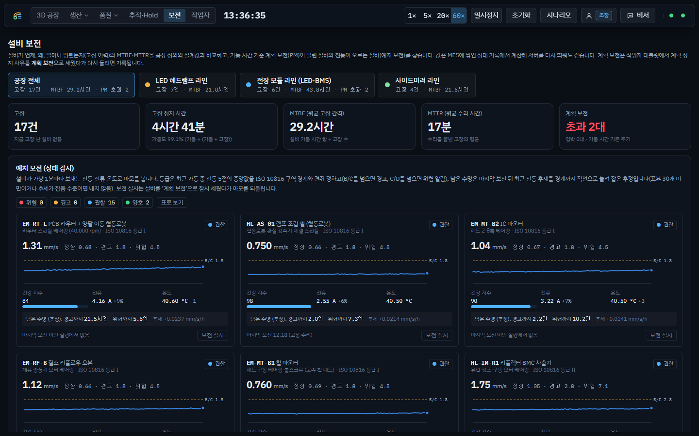 | 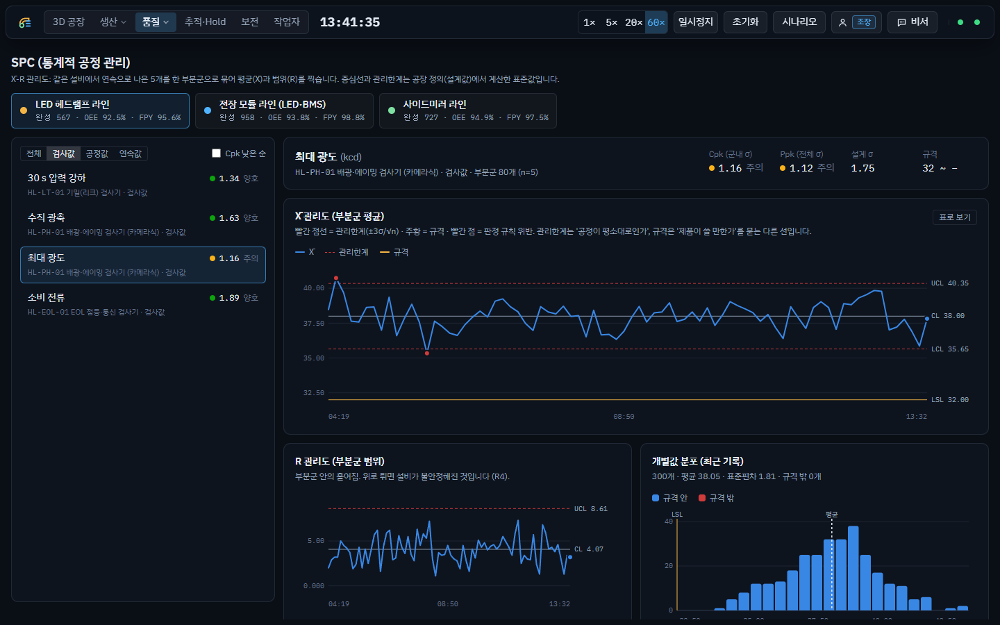 |
| **불량 분석** | **추적** |
| 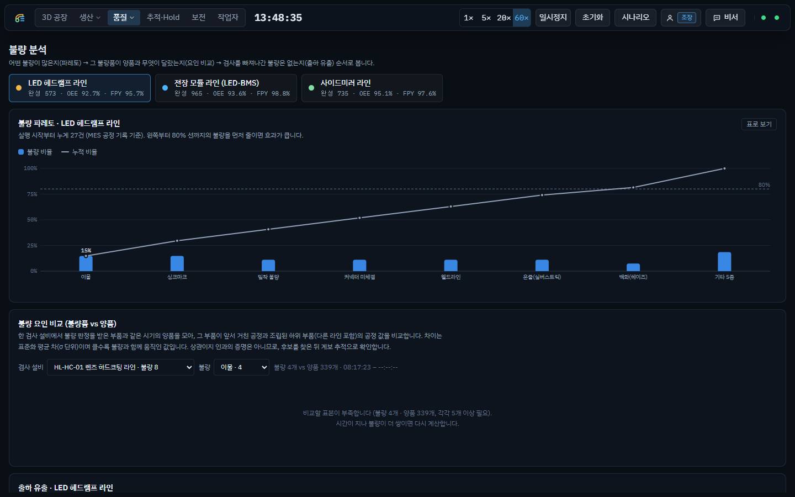 | 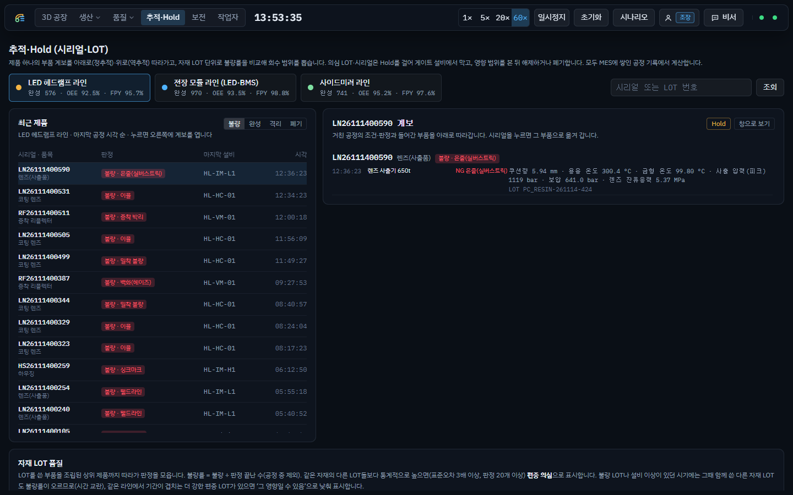 |
| **AI 현장 비서** | **작업자 태블릿** |
| 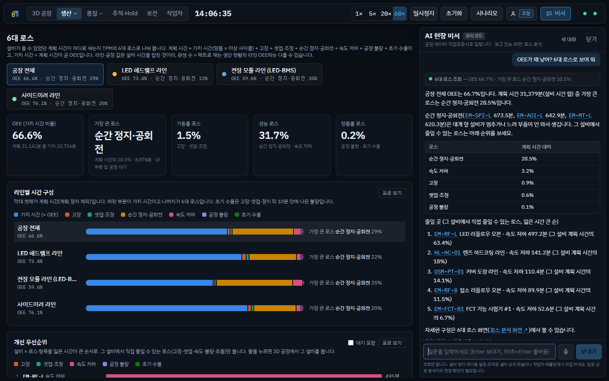 | 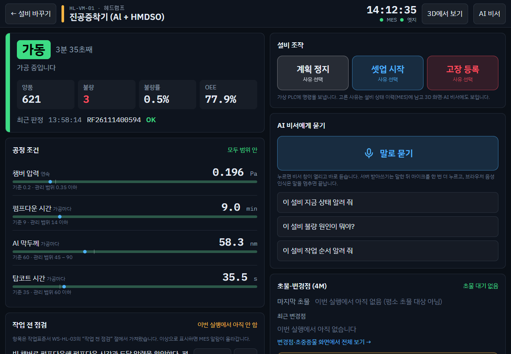 |
| **데이터 경로 (OPC UA)** | |
| 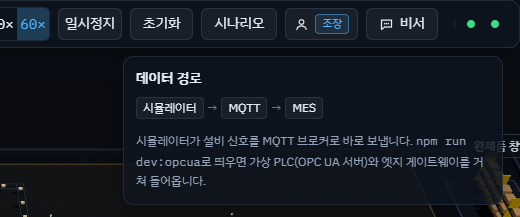 | |

**실행 MES 화면**

| 작업지시·생산 계획 | 불량 처리 (NCR) |
|---|---|
| 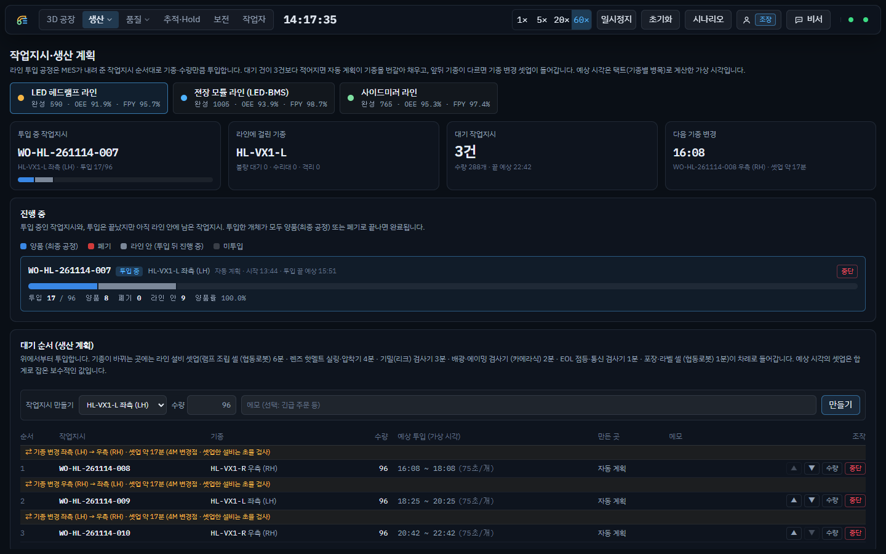 | 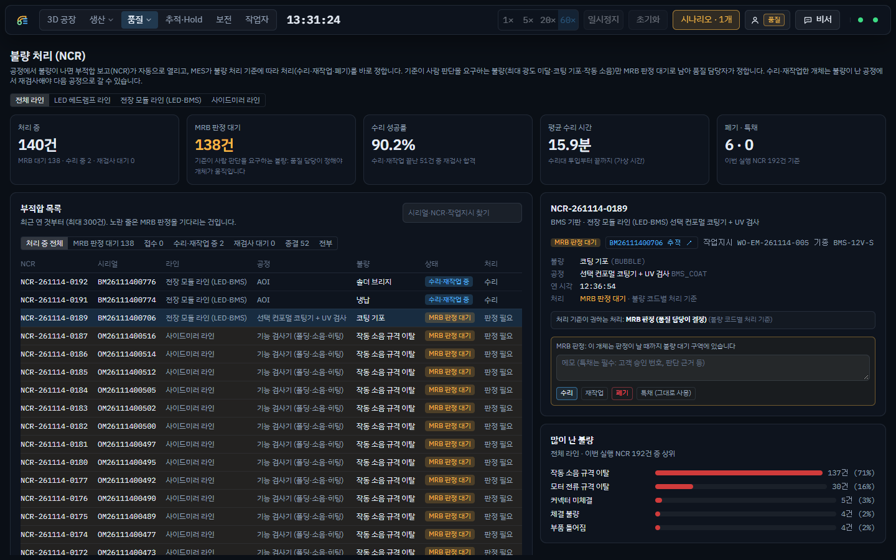 |
| **변경점·초중종물** | **교대 일보** |
| 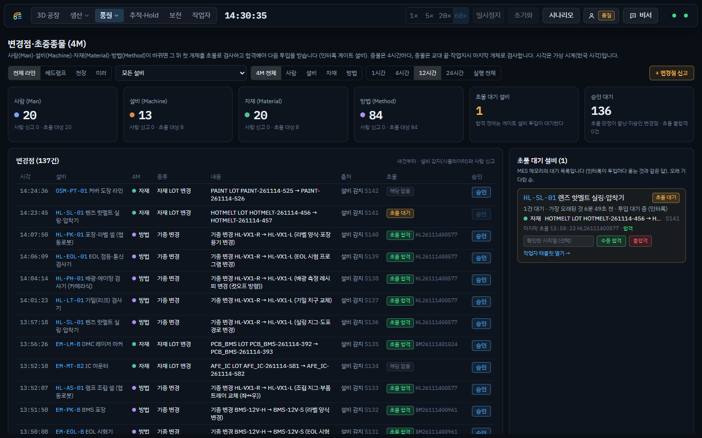 | 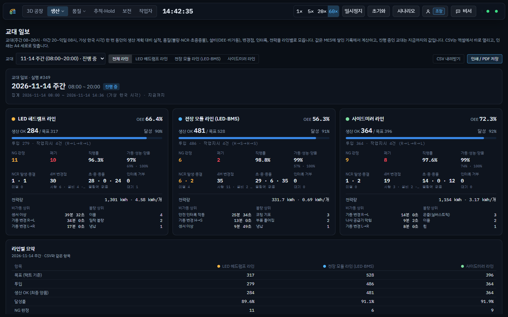 |
| **에너지** | **로그인** |
| 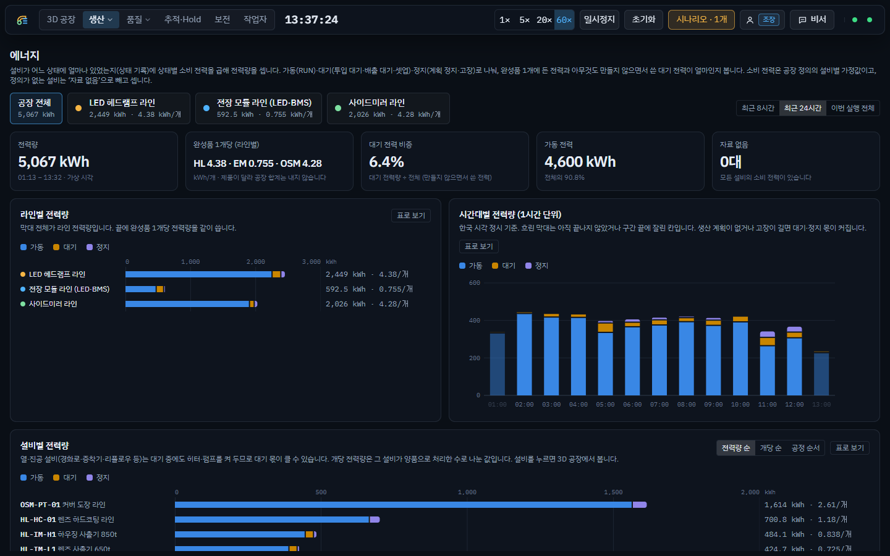 | 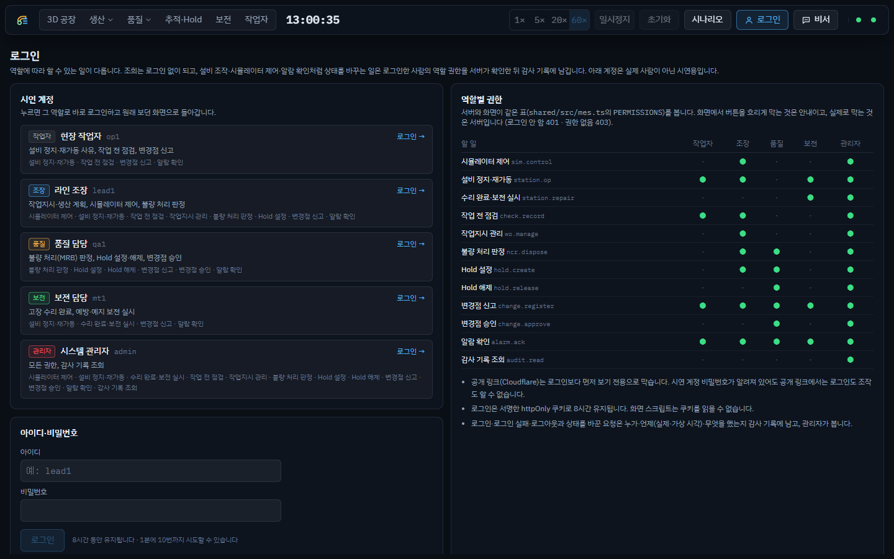 |
| **관리계획서** | **감사 기록** |
| 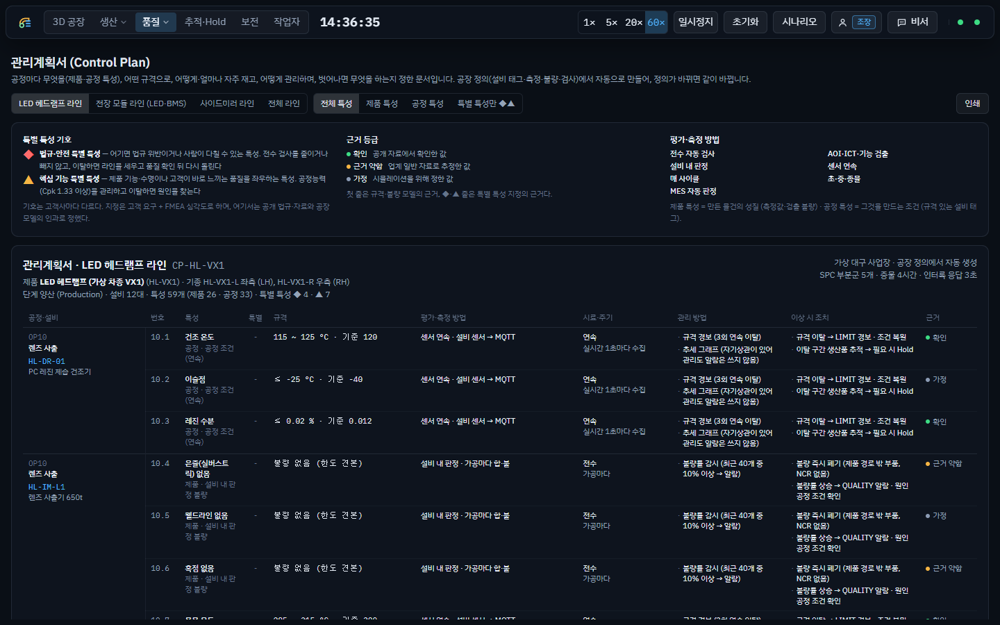 | 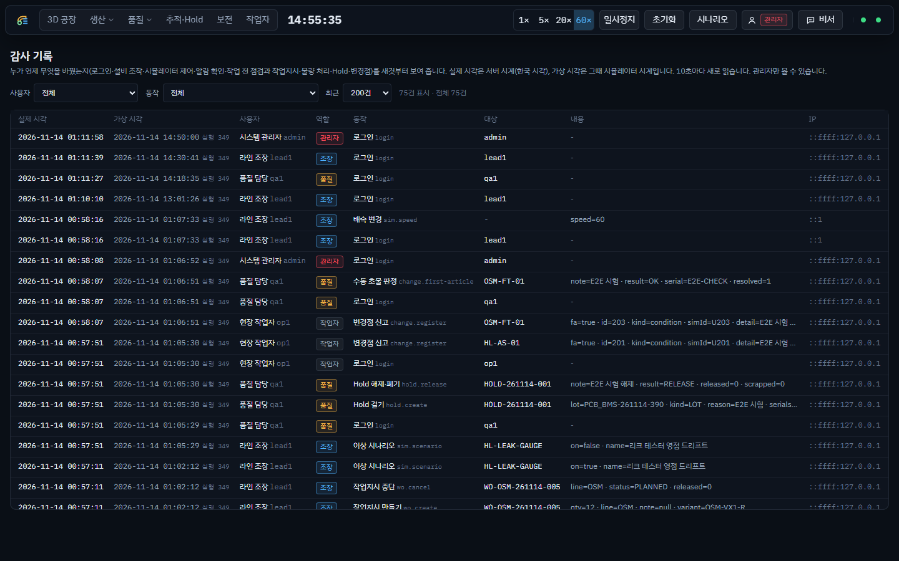 |

화면을 바꾼 뒤에는 앱을 띄워 둔 채 `npm run screenshots`로 다시 찍습니다(설치된 Edge·Chrome을 헤드리스로 씀, `npm run screenshots -- losses spc`처럼 골라 찍기).

## 실행

필요한 것: Node.js 22.19 이상, Python 3(3.14.7에서 확인). PostgreSQL은 `embedded-postgres`로 자동으로 띄우므로 따로 설치하지 않아도 됩니다.

```bash
npm install
```

```bash
npm run sim:setup
```

```bash
npm run dev
```

`npm run dev` 하나로 DB → 공유 패키지 빌드 → MES 서버(마이그레이션 포함) → 화면 → 시뮬레이터가 순서대로 뜹니다. 브라우저에서 http://localhost:5180 을 엽니다.

| 포트 | 용도 |
|---|---|
| 5180 | 화면 (Next.js) |
| 8790 | MES API `/api/v1`, Socket.io |
| 1884 | MQTT 브로커 |
| 54332 | PostgreSQL (DB 이름 `lumitwin`, 데이터는 `.local-db/`) |

같은 와이파이의 태블릿·휴대폰에서는 `http://<이 PC의 IP>:5180/operator`로 들어옵니다. 다만 브라우저는 HTTPS나 localhost에서만 마이크를 허락하므로, 태블릿에서 음성 질문까지 하려면 [공개 링크](deploy/cloudflare/README.md)(HTTPS)로 엽니다.

시뮬레이터만 따로 돌릴 때(배속·난수 시드 지정):

```bash
npm run sim -- --speed 60 --seed 7
```

브로커 없이 최대 속도로 돌려 통계만 볼 때(시나리오 보정용, MES가 없으므로 작업지시·불량 처리는 시뮬레이터 기본 규칙으로 돈다):

```bash
npm run sim -- --offline --hours 8 --scenario EM-NOZZLE-WEAR --at 1
```

### 로그인

조회는 로그인 없이 됩니다. 설비 조작·시뮬레이터 제어·알람 확인·작업지시·불량 판정·Hold·변경점처럼 상태를 바꾸는 일은 로그인한 사람의 역할 권한을 서버가 확인하고 감사 기록에 남깁니다. 화면 위쪽 오른쪽 `로그인` 또는 http://localhost:5180/login 에서 들어갑니다.

| 아이디 | 역할 | 주로 하는 일 |
|---|---|---|
| `op1` | 작업자 | 설비 정지·재가동 사유, 작업 전 점검, 변경점 신고 |
| `lead1` | 조장 | 작업지시·생산 계획, 시뮬레이터 제어, 불량 처리 판정, Hold 걸기 |
| `qa1` | 품질 | 불량 처리(MRB) 판정, Hold 걸기·해제, 변경점 승인·수동 초물 판정 |
| `mt1` | 보전 | 고장 수리 완료, 예방·예지 보전 실시 |
| `admin` | 관리자 | 모든 권한, 감사 기록 조회 |

- 시연용 계정이며 실제 사람이 아닙니다. 서버가 뜰 때 DB(`app_user`)에 만듭니다.
- 비밀번호는 `server/.env`의 `DEMO_PASSWORD`입니다. 정하지 않으면 기본값 `demo1234`이고, 로그인 화면의 계정 버튼을 누르면 비밀번호 없이 바로 들어갑니다. 정하면 계정 버튼은 아이디만 채우고 그 비밀번호를 넣어야 합니다. 공개 배포 때는 바꿉니다.
- 로그인은 서명한 httpOnly 쿠키로 8시간 유지됩니다. 로그인 시도는 IP별 1분에 10번까지입니다.
- 권한 표 전체와 감사 기록 동작 이름은 [docs/MES.md](docs/MES.md)에 있습니다.

| 설정 (`server/.env`) | 값 | 뜻 |
|---|---|---|
| `AUTH` | `on` (기본) · `off` | `off`면 로그인 없이 모두 허용하고 감사 기록에는 `시스템`으로 남는다 |
| `DEMO_PASSWORD` | 비우면 `demo1234` | 시연 계정 5개의 비밀번호 |
| `AUTH_SECRET` | 32자 이상 무작위 | 로그인 쿠키 서명 키. 비우면 처음 뜰 때 만들어 `server/.auth-secret`에 저장한다(git 제외). 바꾸면 모든 로그인이 풀린다 |
| `AUTH_COOKIE_SECURE` | `auto` (기본) · `on` · `off` | 쿠키 `Secure` 속성. `auto`는 HTTPS로 들어온 요청에만 붙인다 |

공개 링크(보기 전용)에서는 로그인보다 보기 전용이 먼저 막습니다. 공개 링크 방문자는 비밀번호를 알아도 로그인할 수 없고, 시연자는 `보기 전용`을 눌러 제어 키를 넣은 뒤 로그인합니다.

### OPC UA 경로로 돌리기 (선택)

설비 신호가 가상 PLC(OPC UA 서버, `opc.tcp://127.0.0.1:4840/lumitwin/`) → 엣지 게이트웨이 → MQTT로 들어옵니다. OPC UA 라이브러리(`asyncua`)를 한 번 설치합니다.

```bash
npm run sim:setup:opcua
```

```bash
npm run dev:opcua
```

화면 위쪽 맨 오른쪽의 두 번째 연결 점(1536px 이상 넓은 화면에서는 `OPC UA` 글자가 붙는다)을 누르면 데이터 경로와 엣지 게이트웨이 상태(탐색한 설비·태그 수, 받은 이벤트, 버퍼, 빠진 실적, 재연결)가 보입니다. UaExpert 같은 OPC UA 클라이언트로 4840에 붙어 주소 공간(`Objects/LumiTwin/라인/설비/Tags`)과 이벤트를 직접 볼 수도 있습니다. 엣지만 따로 띄울 때는 `npm run edge -- --opcua opc.tcp://주소:4840/ --host 브로커 --port 1883`.

### 테스트

**자동 테스트** (앱을 띄우지 않고 돈다. 같은 검사가 GitHub Actions에서 올릴 때마다 돈다):

```bash
npm test
```

공장 정의(shared), MES 계산(server: OEE·6대 로스·SPC·보기 전용·설비 보전·AI 비서 도구·인터록·자동 계획·불량 처리·변경점·관리계획서·교대 일보·에너지·예지 보전·로그인), 시뮬레이터(sim: 결정성·시나리오·재가동 초품·시계·실행 MES 흐름, OPC UA 경로)를 돕니다. `asyncua`가 없으면 OPC UA 서버를 띄우는 테스트만 건너뜁니다.

**화면 E2E** (앱을 `npm run dev`로 띄운 상태에서):

```bash
npm run e2e
```

헤드리스 Edge·Chrome을 DevTools 프로토콜로 움직입니다(추가 패키지 없음). 묶음은 세 가지입니다.

| 묶음 | 보는 것 |
|---|---|
| `pages` | 화면 17개(3D 공장, MES 화면, 감사 기록, 작업자 태블릿, 로그인)가 오류 없이 열리고 제목 글자가 보이는가 (콘솔 오류 포함) |
| `auth` | 로그인 안 하면 쓰기 401, 작업자는 작업지시를 못 만듦(403), 시연 계정 버튼으로 로그인 |
| `execution` | 라인마다 진행 중 작업지시, 조장의 작업지시 만들기·중단, NCR 자동 판정, 품질의 LOT Hold 걸기·해제, 작업자 변경점 신고 → 초물 대기, 품질의 수동 초물 판정, 교대 일보 CSV, 관리자 감사 기록 |

`npm run e2e -- pages auth`처럼 묶음을 고를 수 있습니다. 화면 주소는 `E2E_BASE`(기본 `http://localhost:5180`), 브라우저 경로는 `BROWSER`, 서버에 `DEMO_PASSWORD`를 정했다면 같은 값을 환경 변수로 줍니다.

**부하 측정** (앱을 띄운 상태에서):

```bash
npm run loadtest
```

기본은 10분 관찰 + 조회 API 30초 부하(동시 사용자 20명)입니다. MQTT 메시지 초당 건수, 인터록·작업지시 요청 → 응답 시간(p50·p95·p99), 시뮬레이터가 배속을 따라가는 비율, MES 메모리·DB 기록 큐·DB 크기, 조회 API 응답 시간을 잽니다. `npm run loadtest -- --minutes 30 --users 50 --api-seconds 60 --speed 60 --out docs/perf/run.json`처럼 바꿀 수 있습니다(`--speed`는 `lead1`로 로그인해 배속을 바꾼다).

**측정 결과** (노트북 Ryzen 5 7430U(6코어)·메모리 14 GB 한 대에 운영 빌드 전체, 60배속 10분 관찰 + 동시 사용자 20명이 조회 API 12개를 쉬지 않고 30초간 호출, 원본 [docs/perf/loadtest-60x-10min.json](docs/perf/loadtest-60x-10min.json))

| 항목 | 결과 |
|---|---|
| 인터록 요청 → MES 판정 | 10,574건 · p50 0.2 ms · p95 1.0 ms · p99 26.7 ms · 최대 95 ms · **응답 못 받음 0건** |
| 시뮬레이터가 60배속을 따라간 비율 | 평균 100 % · 최저 96.9 % |
| MES가 받은 설비 메시지 | 초당 약 216건, DB 기록 큐 버림 **0건** (10분간 82,965건 기록) |
| MES 서버 메모리 | 187 → 287 MB (10분 뒤 최대 287 MB) |
| 조회 API 20명 동시 | 30초간 30,986건(초당 약 1,033건) · p50 15 ms · p95 40 ms · p99 74 ms · 오류 0건 |

처음 측정에서는 조회 API p95가 2,087 ms였습니다. 끝점별로 나눠 보니 에너지(p50 1,589 ms)와 설비 보전(p50 940 ms) 집계가 요청마다 이번 실행의 설비 상태 기록(`state_event`)을 처음부터 다시 읽어 계산하며 다른 조회까지 줄 세우고 있었습니다. 두 집계에만 짧은 캐시(에너지 3초·보전 2초, 같은 질의가 동시에 오면 한 번만 계산)를 넣고 다시 재서 p95 40 ms가 됐습니다. 과정은 [docs/perf/README.md](docs/perf/README.md)에 있습니다.

### AI 현장 비서 설정 (선택)

아무것도 하지 않으면 **모의 모드**로 돕니다(키 없이 실제 데이터를 조회해 정해진 틀로 답함). `server/.env`([예시](server/.env.example))에 키를 넣고 서버를 다시 띄우면 Claude가 같은 도구로 자유로운 질문에 답합니다.

```
ANTHROPIC_API_KEY=...
```

음성 질의는 기본으로 브라우저 음성 인식(Chrome·Edge)을 씁니다. 로컬 Whisper로 받아쓰려면 한 번 설치하고 띄운 뒤, `server/.env`에 `STT_BASE_URL=http://localhost:8792`를 넣습니다. 처음 실행할 때 small 모델(약 460MB)을 `tools/whisper/.models`에 받습니다. Whisper 서버가 꺼져 있으면 저절로 브라우저 음성 인식으로 돌아갑니다.

```bash
npm run whisper:setup
```

```bash
npm run whisper
```

## 공개 링크·배포

**무료 공개 링크 (Cloudflare Tunnel)**: 이 PC에서 운영 빌드를 띄우고 Cloudflare Tunnel로 `https://…trycloudflare.com` 주소를 받습니다. 서버 비용은 없고, 이 PC가 켜져 있는 동안만 열립니다. cloudflared 실행 파일은 `tools/cloudflared/`에 둡니다.

```bash
npm run build
```

```bash
npm run share
```

공개 링크로 들어온 방문자는 보기 전용입니다. 화면·실시간 값·AI 비서는 쓰지만 배속·시나리오·초기화·설비 조작·점검 기록·작업지시·불량 판정·Hold·변경점은 막히고, 로그인도 할 수 없습니다. 시연자는 화면의 `보기 전용`을 눌러 `server/.env`의 `CONTROL_KEY`를 넣고(`조작 가능`으로 바뀜), 그다음 역할에 맞는 계정으로 로그인합니다. 고정 주소(이름 붙인 터널), 특정 메일만 들어오게 막기, 설정은 [deploy/cloudflare/README.md](deploy/cloudflare/README.md)에 있습니다.

| 명령 | 하는 일 |
|---|---|
| `npm run start` | 운영 모드로 DB·MES·화면·시뮬레이터 띄우기 (`npm run build` 뒤) |
| `npm run tunnel` | 떠 있는 화면(5180)에 터널만 붙이기 |
| `npm run share` | 위 둘을 한 번에 |

**상시 서버**: PC를 꺼도 열려 있는 링크가 필요하면 Linux 서버 한 대(Ubuntu 24.04, 램 4GB)에 Caddy(HTTPS 자동 인증서)와 pm2로 전부 올립니다. 설치 스크립트 하나가 서버 준비부터 기동·재부팅 자동 시작까지 합니다.

- **무료**: Oracle Cloud 상시 무료 ARM 서버(A1, 2 OCPU · 4GB)와 무료 주소(DuckDNS). 가입, VM 만들기, 방화벽, 주소, 회수 규칙, 로그인 설정은 [deploy/oracle/README.md](deploy/oracle/README.md)에 있습니다.
- **유료**: AWS EC2·Lightsail 같은 다른 Ubuntu 서버. [deploy/aws/README.md](deploy/aws/README.md)

```bash
SIM_LINK=opcua bash deploy/aws/setup-ubuntu.sh 이름.duckdns.org
```

도메인 자리에 `auto`를 넣으면 공인 IP로 `a-b-c-d.sslip.io` 주소를 만듭니다. `SIM_LINK=opcua`는 설비 신호를 OPC UA 경로(가상 PLC → 엣지 게이트웨이 → MQTT)로 보냅니다.

## 시연 순서

면접용 3분 대본, 시연 영상 녹화 절차, 예상 질문은 [docs/DEMO.md](docs/DEMO.md)에 있습니다. 아래는 기능을 하나씩 둘러보는 순서입니다.

1. **공장 전체**: 왼쪽 라인 카드에서 완성 수, 최근 1시간/목표, OEE와 가동률·성능·양품률, FPY, 지금 작업지시와 다음 기종을 본다. `lead1`(조장)로 로그인하고 배속을 60×로 올린다.
2. **작업지시·기종 변경**: `생산` → `작업지시·생산 계획`. 대기 순서에서 기종이 바뀌는 곳(⇄)과 셋업 시간이 보인다. 다른 기종 작업지시를 `만들기`로 넣고 ▲로 올리면, 투입 공정부터 설비가 차례로 `SETUP`(기종 변경)에 들어가고 셋업이 끝난 설비마다 초물을 검사한다.
3. **이상 시나리오**: 위쪽 `이상 시나리오`에서 `LED 마운터 노즐 마모`를 켠다. 원인은 전장 라인에 있지만 헤드램프 라인의 배광 검사에서 불량이 늘어난다.
4. **알람 → 설비**: 왼쪽 아래 알람을 누르면 카메라가 그 설비로 날아가고 상세 패널이 열린다. 상태 시간, 공정 조건, 불량 인과(원인 태그 ← 표시), SPC 관리도와 Cpk를 본다.
5. **SPC → 불량 분석**: `SPC`에서 배광 검사기의 광축 관리도가 위로 흘러가는 것을 보고, `불량 분석`의 요인 비교에서 불량 램프에만 큰 값이 다른 라인 LED 마운터의 장착 편차임을 확인한다.
6. **자재 LOT → 불량 처리 → Hold**: `웜기어 세트 불량 LOT 입고`를 켜면 사이드미러 기능 검사의 소음 불량이 는다. 소음 불량은 처리 기준이 MRB라 `품질` → `불량 처리`에 MRB 판정 대기로 쌓인다. `불량 분석`의 `자재 LOT 편중`에서 그 LOT를 누르면 `추적·Hold`로 넘어가 LOT별 불량률과 회수·격리 범위가 보인다. LOT 상세의 `이 LOT Hold`로 Hold를 걸면 그 LOT를 쓴 재공품이 다음 게이트 설비에서 거부돼 격리 구역에 모인다. 해제·폐기는 `qa1`(품질)로 한다.
7. **변경점·초물**: `품질` → `변경점·초중종물`에서 기종 변경·교대·LOT 변경으로 생긴 변경점과 초물 대기 설비를 본다. 초물이 합격하면 `qa1`로 `승인`한다.
8. **예지 보전**: `칩 마운터 헤드 베어링 마모`를 켜고 `보전` 화면의 예지 보전 영역을 본다. 60배속에서 약 2~4분 뒤 EM-MT-B1 진동이 경고 구역에 들어가고, 약 5~6분 뒤부터 '이음·진동' 고장 위험이 커진다. 경고가 뜨면 `mt1`(보전)로 `보전 실시`를 누른다.
9. **교대 일보**: `생산` → `교대 일보`에서 교대를 골라 `CSV 내려받기`와 `인쇄 / PDF 저장`을 본다.
10. **원격 명령**: `고장 주입` → 라인 카드에 고장 설비가 뜨고 3D 경광등이 빨갛게 바뀐다 → `수리 완료`(보전 권한). `생산 현황`의 시간대별 막대가 목표선 아래로 내려간다.
11. **AI 현장 비서**: `AI 비서`를 열고 "사이드미러 기능 검사 소음 불량 원인이 뭐야?"라고 묻는다(마이크로 말해도 된다). 비서가 파레토 → 요인 비교 → LOT 비교 → 작업표준서 검색을 차례로 부르는 것이 보이고, "웜기어 LOT가 원인일 가능성이 크다"와 함께 `[WS-OSM-02 §7]` 이상 조치를 인용한다. 인용을 누르면 표준서가 그 절로 열리고, LOT를 누르면 `추적·Hold`의 회수 범위로 간다.
12. **작업자 태블릿**: 태블릿(또는 브라우저 폭을 줄인 창)에서 `작업자` → `HL-VM-01 진공증착기`. `op1`(작업자)로 로그인한다. `증착 챔버 미세 누설`을 켜 두면 공정 조건에 펌프다운 시간 이탈이 뜬다. 작업 전 점검에서 첫 항목을 `이상`으로 기록하면 MES 알람이 오르고, `고장 등록` → `누설`을 고르면 3D 경광등과 알람에 "누설 (작업자 등록)"이 보인다. `변경점 신고`로 4M 변경을 올리면 그 설비에 초물 대기가 생긴다.

## 폴더

| 폴더 | 기술 | 역할 |
|---|---|---|
| [`shared/`](shared) | TypeScript, tsup | 공장 정의(라인·설비·태그·불량 인과·기종·처리 기준·전력·상태 감시·시나리오)의 단일 원본과 실행 MES 공용 규칙(`mes.ts`: 역할·권한·교대·작업지시·인터록·불량 처리·예지 보전 기준). 빌드할 때 `factory.json`도 내보내 Python이 같은 정의를 읽는다 |
| [`sim/`](sim) | Python, SimPy, paho-mqtt, asyncua(선택) | 가상 공장·PLC. 설비 상태 기계, 버퍼, 배치·터널 설비, MTBF/MTTR 고장, 품질 인과, 재가동 초품, AMR, 작업지시·인터록 요청, 불량 대기·수리대·격리 구역, 4M 변경점·초중종물, 마모·상태 감시. 선택: OPC UA 서버(`opcua_plc.py`)와 엣지 게이트웨이(`edge.py`) |
| [`server/`](server) | NestJS 12, Prisma 7, PostgreSQL, aedes, Socket.io | MQTT 수집, 실시간 OEE·SPC·알람, 일괄 기록, 추적 API, 시뮬레이터 제어, 실행 MES(작업지시·인터록·NCR·Hold), 품질 시스템(변경점·초중종물), 분석(교대 일보·에너지·예지 보전), 로그인·권한·감사 기록 |
| [`client/`](client) | Next.js 16, React 19, React Three Fiber, Tailwind 4, TanStack Query, zustand | 3D 공장(설비 24종을 공정군별 파일로 절차적 모델링, 부위 이름표, 개발용 미리보기 `/dev/machines`), HUD, 상세 패널(설비마다 하는 일·앞뒤 공정 안내), 계보 창, MES 화면 12개(차트는 라이브러리 없이 SVG로 직접 그림), 로그인·감사 기록, AI 비서 패널 |
| [`scripts/`](scripts) | Node.js | 개발 실행(DB·시뮬레이터·Whisper), 화면 캡처, 화면 E2E(`e2e.mjs`), 부하 측정(`loadtest.mjs`) |
| [`tools/whisper/`](tools/whisper) | Python, faster-whisper | 선택: OpenAI 호환 로컬 음성 받아쓰기 서버 |
| [`deploy/cloudflare/`](deploy/cloudflare) | cloudflared | 무료 공개 링크: 이 PC를 Cloudflare Tunnel로 공개하는 방법(`scripts/tunnel.mjs`)과 보기 전용 설정 |
| [`deploy/aws/`](deploy/aws) | bash, pm2, Caddy | 상시 서버 한 대 배포: 설치·갱신 스크립트, pm2 프로세스 정의, Caddyfile, 운영용 `.env` 예시 |
| [`deploy/oracle/`](deploy/oracle) | — | 무료 상시 서버: Oracle Cloud 상시 무료 ARM VM을 만들어 위 스크립트로 올리는 순서 |
| [`docs/`](docs) | — | [설계 문서](docs/DESIGN.md), [MES 화면·역할 안내](docs/MES.md), [시연 대본](docs/DEMO.md), [현업 적용까지 남은 것](docs/PRODUCTION-GAP.md), [성능 측정 기록](docs/perf/README.md), 공정 리서치 4편, [가상 작업표준서 15건](docs/standards) |

## 주요 API (`/api/v1`)

조회(GET)는 로그인 없이 열려 있습니다. 상태를 바꾸는 요청은 괄호 안의 권한이 필요하고(로그인 안 함 401, 권한 없음 403), 감사 기록에 남습니다.

| 경로 | 내용 |
|---|---|
| `GET factory` | 공장 정의 + 불량 이름 |
| `GET live/snapshot` | 설비·라인·AMR 실시간 상태 |
| `GET live/spc/:station` | 설비의 X̄-R 관리도, Cpk |
| `GET live/losses` | 6대 로스: 설비별 시간 구성(가상 초)과 라인·공장 합계, 재가동 직후 불량 수 |
| `GET live/alarms`, `POST live/alarms/:id/ack` | 알람 목록·확인 (`alarm.ack`) |
| `GET maintenance?run=` | 설비 보전: 설비별 고장 수·고장 시간·MTBF·MTTR 실적과 설계·가용도, 계획 보전 경과와 상태, 마지막 작업 전 점검, 최근 고장·계획 보전 구간(300건), 고장 사유 합계 (DB 기준) |
| `GET maintenance/health`, `GET maintenance/health/:station` | 예지 보전: 설비별 진동 등급·건강 지수·남은 수명 추정·최근 표본 / 한 설비의 상세 |
| `GET production/trace/:serial` | 시리얼 계보(하위 부품까지 재귀) |
| `GET production/ancestors/:serial` | 이 부품이 들어간 상위 제품 |
| `GET production/lots/:lot` | 자재 LOT → 쓴 부품(설비별) → 조립돼 들어간 맨 위 제품(회수 범위) |
| `GET production/lot-quality?material=` | 자재 LOT별 부품 수·불량·완성 (상위 제품까지 따라가 판정) |
| `GET production/units?line=&status=` | 제품 현재 상태 목록 (상태: WIP·NG·DONE·CONSUMED·SCRAP·HOLD·REPAIR) |
| `GET production/factors/:station?defect=` | 불량 요인 비교: 불량품과 같은 시기 양품의 공정값·부품 속성 차이(효과 크기) + 불량품 쪽에 몰린 자재 LOT |
| `GET production/defects?line=` | 설비·불량 코드별 누계 (DB 기준, 파레토와 요인 분석 대상 목록) |
| `GET production/hourly/:line` | 시간대별 생산·불량 |
| `GET production/escapes` | 검사를 빠져나간 잠재 불량 |
| `GET orders?line=&status=` | 작업지시 목록(예상 투입 시각 포함) |
| `POST orders` · `PATCH orders/:id` · `POST orders/:id/cancel` · `POST orders/reorder` | 작업지시 만들기 `{line, variant, qty, note?}` · 수량·메모 고치기(수량은 대기 중일 때만) · 중단 · 대기 순서 바꾸기 `{line, ids}` (`wo.manage`) |
| `GET ncr?status=&line=`, `GET ncr/:id` | 불량 처리(NCR) 목록·요약 / 상세(같은 시리얼 이력) |
| `POST ncr/:id/disposition` | 판정 `{decision: REPAIR·REWORK·SCRAP·UAI, note?}` (특채는 메모 필수, `ncr.dispose`) |
| `GET holds?status=`, `GET holds/:id` | Hold 목록 / 상세(영향 범위, 격리 묶음) |
| `POST holds` | Hold 걸기 `{kind: LOT·SERIAL, material?, lot?, serials?, reason}` (`hold.create`) |
| `POST holds/:id/release` | 해제 `{result: RELEASE·SCRAP, note}` (메모 필수, `hold.release`) |
| `GET interlock?line=&station=` | 인터록 통계(통과·거부·대기·무응답 통과)와 최근 거부·대기 |
| `GET execution/summary` | 라인별 진행 작업지시·다음 작업지시·격리·NCR 수 (3D 라인 카드용) |
| `GET changes?line=&station=&category=&from=&to=&limit=` | 4M 변경점 |
| `POST changes` | 변경점 신고 `{station, category, detail, fa, kind?}` (`change.register`) |
| `POST changes/:id/approve` | 변경점 승인(품질 확인 서명, 초물 판정이 끝난 것만) (`change.approve`) |
| `GET inspections?line=&station=&type=&from=&to=&limit=` | 초·중·종물 검사 기록 |
| `GET quality-system/fa-status` | 설비별 초물 대기 (인터록과 같은 답) |
| `POST quality-system/fa/:station` | 수동 초물 판정 `{result: OK·NG, serial?, note?}` (`change.approve`) |
| `GET reports/shifts` · `GET reports/shift?key=2026-11-13-D&line=` · `GET reports/shift.csv?key=` | 교대 목록 · 교대 일보 · CSV(UTF-8 BOM) |
| `GET energy?from=&to=&line=&hours=` | 전력량(설비·라인·시간대, 가동·대기·정지 몫)과 개당 전력량. `from`이 없으면 `hours`(기본 24)만큼 거슬러 |
| `GET sim/status` | 시뮬레이터 상태(라인별 작업지시·불량 대기·수리대·격리 포함), 데이터 경로(`link`: mqtt·opcua), OPC UA 경로면 엣지 게이트웨이 상태 |
| `POST sim/speed` · `pause` · `resume` · `reset` · `scenario` | 시뮬레이터 원격 제어 (`sim.control`) |
| `POST sim/station` | 설비 명령 `{code, op: stop·setup·start·repair·fail·pm, reason?}` (사유 40자). `repair`·`pm`은 `station.repair`, 나머지는 `station.op` |
| `GET access` | 이 접속이 보기 전용인지(`{readOnly, unlockable}`). 공개 링크(Cloudflare를 거친 요청)는 쓰기 요청이 403, 제어 키는 `x-lumitwin-key` 머리글 |
| `POST auth/login` · `POST auth/logout` · `GET auth/me` | 로그인 `{login, password}`(기본 비밀번호 서버는 `{login, demo: true}`도 됨) · 로그아웃 · 내 정보 `{enabled, user, demo}` |
| `GET auth/users`, `GET audit?user=&action=&limit=` | 계정 목록 · 감사 기록(`action` 끝에 `*`면 앞부분 일치) (`audit.read`) |
| `GET operator/checks?station=&limit=`, `POST operator/checks` | 작업 전 점검 기록 조회(이번 실행, 최근 순)·저장(`{station, doc, items: [{text, ok}], by}`, 이상이 있으면 알람) (`check.record`) |
| `GET assistant/info` | 비서 모드(Claude·모의), 음성 받아쓰기 가능 여부, 추천 질문 |
| `POST assistant/chat` | 질문 → NDJSON 이벤트 흐름(도구 호출·결과·답 조각·완료) |
| `GET assistant/standards`, `GET assistant/standards/:id` | 작업표준서 목록·본문(조건표를 공장 정의로 채움) |
| `POST assistant/transcribe` | 음성(multipart `audio`) → 받아쓴 글 |

`reports/*`, `energy`는 `run=`으로 지난 실행도 볼 수 있습니다.

## 다음 단계

현업에 넣을 때 필요한 것(설비 통신·ERP 연동·기준정보 관리·장애 대응·데이터 보관·보안)과 넣는 순서는 [docs/PRODUCTION-GAP.md](docs/PRODUCTION-GAP.md)에 코드 근거와 함께 있습니다. 아래는 이 저장소에서 바로 이어 할 일입니다.

- 늘 켜 둘 링크: Oracle 상시 무료 VM에 실제로 올려 보기 (스크립트·안내서는 준비됨, Linux·ARM에서 아직 돌려 보지 않음). 올린 뒤 시연 계정 비밀번호(`DEMO_PASSWORD`)와 `AUTH_COOKIE_SECURE=on`을 정한다
- 시연 영상: [docs/DEMO.md](docs/DEMO.md)의 3분 대본으로 녹화해 링크를 README에 붙이기
- 고정 주소 공개 링크: Cloudflare 계정·도메인으로 이름 붙인 터널 쓰기 (스크립트는 토큰만 넣으면 됨)
- OPC UA 경로에 보안 정책(Basic256Sha256 서명·암호화, 인증서) 켜기. 지금은 로컬 시연용으로 SecurityPolicy None·익명 접속
- 작업자 명령(정지·셋업·재가동)도 OPC UA 메서드로 PLC에 내리기. 지금은 MQTT로 시뮬레이터에 바로 간다
- 실행 MES 다듬기: 초물 대기가 오래되면 알람 내기, 변경점에서 관리계획서·PFMEA 개정 필요 여부로 잇기, 교대 목표를 생산 계획의 교대 계획 수량으로 잡기
- 계정 관리: 사내 계정(SSO) 연동, 판정 때 재인증(전자 서명), 감사 기록 위변조 방지(해시 체인). 지금은 시연 계정 5개뿐이고 비밀번호 바꾸기 화면이 없다
